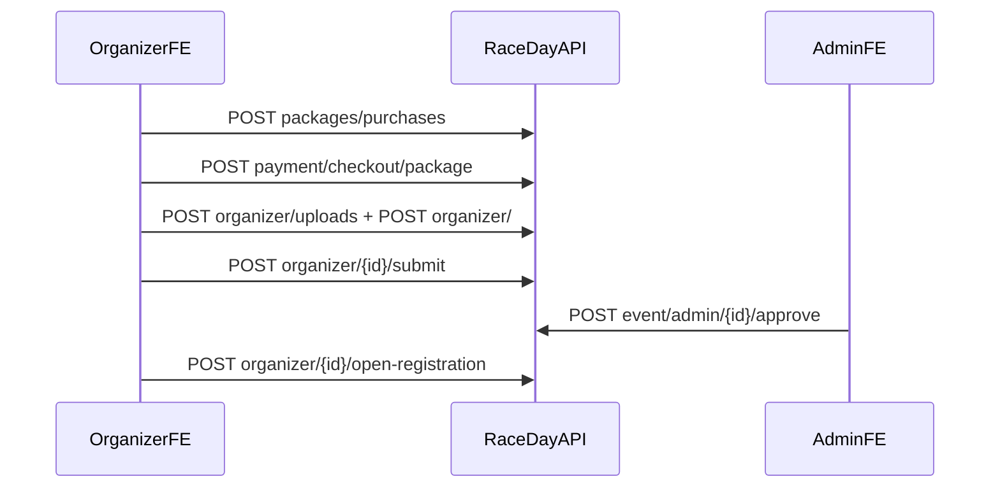

# RaceDay API — theo luồng nghiệp vụ (khớp FE)

> **Trạng thái tài liệu**
>
> - `docs/RaceDay_API_Guide.docx` = bản Word đã sync từ file này (chạy `docs/_md_to_docx.py` nếu sửa md).
> - Nguồn đúng theo code hiện tại + field FE True / Admin đã gọi.
> - Base URL local: `http://localhost:5080`
> - Auth: header `Authorization: Bearer <accessToken>` (từ login).
> - JSON: **camelCase**. Lỗi validation/domain → HTTP **400** body `{ "error": "…" }` (nhiều message nối bằng `; `).

Seed demo: `admin@raceday.vn` / `cuong.le@raceday.vn` / `binh.tran@raceday.vn` — mật khẩu `MatKhau@123`.  
Flagship: **VnExpress Marathon Quy Nhon 2026** id `11111111-aaaa-4aaa-8aaa-aaaaaaaaaaa1`.

---

## 0. Convention lỗi

| HTTP | Khi nào | Body |
|------|---------|------|
| 400 | FluentValidation / DomainException / DB constraint | `{ "error": "Email không hợp lệ; …" }` |
| 401 | Thiếu/invalid JWT | redirect FE login |
| 403 | Sai policy (AdminOnly…) | FE → `/403` |
| 404 | Không tìm thấy (một số route) | — |
| 429 | Rate limit | — |

Sample lỗi:

```json
{ "error": "Số điện thoại không hợp lệ (VD: 09xxxxxxxx)." }
```

```json
{ "error": "Họ tên không được để trống.; Cần chấp nhận điều khoản trách nhiệm." }
```

---

## A. Auth (User FE + Admin FE) — `api/v1/iam`

### A1. Đăng ký → OTP → Login

**FE:** `SEP_True_Frontend_User/src/api/auth.ts`

#### `POST /api/v1/iam/auth/register`

Request (FE gửi):

```json
{
  "email": "runner@example.com",
  "username": "runner01",
  "password": "MatKhau@123",
  "fullName": "Nguyễn Văn A",
  "phone": "0901234567",
  "gender": 0,
  "dateOfBirth": "1998-05-20"
}
```

| Field | Bắt buộc | Hướng dẫn |
|-------|----------|-----------|
| email | ✓ | Email thật (nhận OTP) |
| username | ✓ | ≥ 3 ký tự, unique |
| password | ✓ | Theo rule IAM (≥ 8, có chữ/số/ký tự đặc biệt tùy validator) |
| fullName | ✓ | Không trống |
| phone | | VN `09/08/07/05/03…` hoặc `+84…` |
| gender | | số (FE: 0) |
| dateOfBirth | | `yyyy-MM-dd`, tuổi hợp lệ |

Response: `200` (thường empty/ok).  
Lỗi mẫu: email trùng, phone sai, password yếu.

#### `POST /api/v1/iam/auth/verify-email`

```json
{ "email": "runner@example.com", "otp": "123456" }
```

#### `POST /api/v1/iam/auth/resend-otp`

```json
{ "email": "runner@example.com" }
```

#### `POST /api/v1/iam/auth/login`

```json
{ "username": "runner01", "password": "MatKhau@123" }
```

> FE cũng chấp nhận nhập email vào ô username — gửi field **`username`**.

Response (FE đọc `accessToken` hoặc `token`):

```json
{
  "userId": "bbbbbbbb-bbbb-bbbb-bbbb-bbbbbbbbbbbb",
  "username": "runner01",
  "accessToken": "eyJhbGciOi…",
  "expiredTime": 604800000,
  "role": "User"
}
```

#### Khác

| Method | Path | Auth | FE |
|--------|------|------|----|
| POST | `/auth/forgot-password` | — | `{ "email" }` |
| POST | `/auth/reset-password` | — | `{ "email", "otp", "newPassword" }` |
| POST | `/auth/change-password` | JWT | `{ "currentPassword", "newPassword" }` |
| GET | `/me` | JWT | profile |

Admin FE login cùng IAM (`admin@raceday.vn`).

---

## B. Organizer — mua gói → tạo giải → duyệt → mở ĐK

**FE User:** `organizer.ts`, `event-packages.ts`  
**FE Admin:** `admin-events.ts`



### B1. Catalog gói

`GET /api/v1/event/packages/catalog` — public.

### B2. Mua gói

`POST /api/v1/event/organizer/packages/purchases` (JWT)

```json
{
  "orgName": "BTC Quy Nhơn Run",
  "orgIntro": "Câu lạc bộ chạy bộ",
  "orgAddress": "Quy Nhơn, Bình Định",
  "invoiceInfo": "MST…",
  "durationMonths": 6,
  "participantCap": 500,
  "promoCode": "RACEDAY10"
}
```

Tiếp: `POST /api/v1/payment/checkout/package`

```json
{
  "packagePurchaseId": "…guid…",
  "returnUrl": "http://localhost:3000/organizer/packages/return",
  "cancelUrl": "http://localhost:3000/organizer/packages"
}
```

### B3. Upload banner / hồ sơ

`POST /api/v1/event/organizer/uploads?purpose=banner|document`  
`multipart/form-data` field **`file`**.

Response:

```json
{
  "fileName": "banner.jpg",
  "fileUrl": "https://….r2.dev/event-banners/…",
  "contentType": "image/jpeg",
  "sizeBytes": 123456
}
```

### B4. Tạo giải

`POST /api/v1/event/organizer/` (JWT) — body khớp `CreateRaceEventRequest` FE:

```json
{
  "name": "VnExpress Marathon Quy Nhon 2026",
  "tagline": "Chạy đêm thành phố biển",
  "bannerImage": "https://pub-….r2.dev/event-banners/….JPG",
  "location": "Quy Nhơn, Bình Định",
  "coordinates": { "lat": 13.782967, "lng": 109.219663 },
  "date": "2026-06-21",
  "startTime": "04:00:00",
  "description": "…",
  "totalRunners": 500,
  "organizer": {
    "name": "Ban tổ chức VnExpress Marathon Quy Nhơn",
    "email": "cuong.le@raceday.vn",
    "phone": "0904000004",
    "legalEntity": "RaceDay Event Company",
    "website": "https://raceday.vn",
    "beneficiaryAccount": {
      "accountHolder": "CONG TY RACE DAY",
      "accountNumber": "0123456789",
      "bankName": "Vietcombank",
      "branch": "Quy Nhơn",
      "transferNote": "Giai ngan BTC"
    }
  },
  "distances": [
    {
      "type": "10K",
      "name": "City 10K",
      "distanceKm": 10,
      "elevationGainM": 30,
      "maxElevationM": 18,
      "minElevationM": 0,
      "capacity": 1000,
      "price": 650000,
      "currency": "VND",
      "color": "#0ea5e9",
      "startLocation": { "name": "Start", "lat": 13.782967, "lng": 109.219663 },
      "finishLocation": { "name": "Finish", "lat": 13.782967, "lng": 109.219663 }
    }
  ],
  "documents": [
    {
      "documentKey": "plan",
      "title": "Hồ sơ tổ chức",
      "fileName": "plan.docx",
      "fileUrl": "https://pub-….r2.dev/event-docs/….docx",
      "required": true
    }
  ],
  "rules": { "safetyChecklist": true },
  "submitForApproval": true
}
```

| Lỗi thường | Ý nghĩa |
|------------|---------|
| Tên/địa điểm trống | validation |
| Ngày giải ngoài range | ±30 ngày quá khứ / +5 năm |
| Lat/lng invalid | ngoài −90..90 / −180..180 |
| Phone BTC sai | InputRules VN mobile |
| Capacity > gói | domain |
| Chưa có gói active | domain (nếu bắt buộc package) |

### B5. Lifecycle

| FE / Admin | Method | Path | Body |
|------------|--------|------|------|
| User submit | POST | `/api/v1/event/organizer/{id}/submit` | — |
| Admin approve | POST | `/api/v1/event/admin/{id}/approve` | `{ "openRegistration": false }` |
| Admin reject | POST | `/api/v1/event/admin/{id}/reject` | `{ "reason": "…" }` |
| User mở ĐK | POST | `/api/v1/event/organizer/{id}/open-registration` | — |
| User đóng ĐK | POST | `/api/v1/event/organizer/{id}/close-registration` | — |
| Admin list | GET | `/api/v1/event/admin/pending` | — |

> **Quan trọng:** duyệt Admin mặc định **không** mở ĐK (`openRegistration: false`). Cần bước open-registration.

### B6. Map course (sau có distances)

**FE:** `race-map.ts` → `NEXT_PUBLIC_RACE_MAP_USE_MOCK=false`

| Method | Path |
|--------|------|
| GET/PUT | `/api/v1/map/events/{eventId}/distances/{distanceId}/course` |

PUT body (`CourseConfigDto`):

```json
{
  "title": "City 10K",
  "distanceId": "22222222-bbbb-4bbb-8bbb-bbbbbbbbbbb2",
  "distanceKm": 10.05,
  "waypoints": [{ "lat": 13.78, "lng": 109.22 }],
  "polyline": [{ "lat": 13.78, "lng": 109.22 }, { "lat": 13.79, "lng": 109.23 }],
  "checkpoints": [
    { "id": "cp1", "name": "Xuất phát", "km": 0, "lat": 13.78, "lng": 109.22, "type": "start", "cutoff": "04:10" }
  ],
  "updatedAt": "2026-10-13T04:00:00Z"
}
```

OSRM / Nominatim / simulator: **chỉ FE**.

---

## C. Runner — đăng ký → PayOS → chờ duyệt

**FE:** `events.ts`, `payments.ts`

### C1. List / detail giải public

- `GET /api/v1/event`
- `GET /api/v1/event/{eventId}`

### C2. Upload giấy khám

`POST /api/v1/event/uploads` multipart `file` → `health-certs/…`

### C3. Đăng ký

`POST /api/v1/event/{eventId}/registrations` (JWT)

```json
{
  "distanceId": "22222222-bbbb-4bbb-8bbb-bbbbbbbbbbb2",
  "fullName": "Trần Thị Bình",
  "email": "binh.tran@raceday.vn",
  "phone": "0903000003",
  "dateOfBirth": "1999-08-12",
  "gender": "Female",
  "idNumber": "079199001234",
  "heightCm": 160,
  "weightKg": 52,
  "bloodType": "A",
  "emergencyName": "Trần Văn Nam",
  "emergencyPhone": "0903222222",
  "shirtType": "Tee",
  "shirtSize": "S",
  "shirtColor": "White",
  "medicalCodes": ["none"],
  "healthCertFileName": "cert.png",
  "healthCertUrl": "https://pub-….r2.dev/health-certs/….png",
  "liabilityAccepted": true
}
```

| Field | Rule ngắn |
|-------|-----------|
| phone / emergencyPhone | VN mobile |
| dateOfBirth | tuổi 5–100 |
| idNumber | 9 hoặc 12 số |
| bloodType | `A`/`B`/`AB`/`O` ± |
| heightCm / weightKg | 100–250 / 25–250 |
| liabilityAccepted | phải `true` |
| distanceId | thuộc giải, còn slot, giải `registration-open` |

Status sau tạo: **`pending_payment`**.

### C4. Checkout vé

`POST /api/v1/payment/checkout`

```json
{
  "registrationId": "44444444-dddd-4ddd-8ddd-ddddddddddd2",
  "returnUrl": "http://localhost:3000/events/{eventId}/pending",
  "cancelUrl": "http://localhost:3000/events/{eventId}/payment"
}
```

Response (FE normalize `paymentId`):

```json
{
  "id": "…",
  "checkoutUrl": "https://…",
  "amount": 650000,
  "orderCode": 2602011001,
  "status": "Pending",
  "qrCode": "…",
  "accountNumber": "…",
  "accountName": "…",
  "bin": "…",
  "transferDescription": "…"
}
```

Sau returnUrl: `POST /api/v1/payment/{paymentId}/sync` → registration **`pending_approval`**.

### C5. Organizer duyệt VĐV

```http
POST /api/v1/event/organizer/registrations/{registrationId}/approve
{ "bibNumber": null }
```

```http
POST /api/v1/event/organizer/registrations/{registrationId}/reject
{ "reason": "Giấy khám không hợp lệ" }
```

> Reject sau đã trả → Finance **hoàn 100%** `payment.Amount` tự động.

Hủy unpaid: `POST /api/v1/event/registrations/{id}/cancel`.

---

## D. Ví / giải ngân / hoàn tiền — `api/v1/finance`

**FE User:** `finance.ts` (`NEXT_PUBLIC_FINANCE_USE_MOCK=false`)  
**FE Admin:** `admin-finance.ts`

| Ai | Method | Path | Body |
|----|--------|------|------|
| Org | GET | `/organizer/wallet` | — |
| Org | PUT | `/organizer/bank-account` | `{ bankName, accountNumber, accountHolderName, branch?, transferNote? }` |
| Org | POST | `/organizer/payouts` | `{ eventId, amount, note? }` |
| Org | GET | `/organizer/events/{eventId}/summary` | — |
| Runner | POST | `/runner/refunds` | `{ paymentId, reason, eventId?, amount? }` |
| Admin | GET/POST | `/admin/payouts`, `…/approve`, `…/reject` | approve: `{ receiptUrl? }` reject: `{ reason }` |
| Admin | GET/PUT | `/admin/settings` | fee %, withdraw %, refund % |

**Hoàn tiền (policy):**

| Giai đoạn giải | % hoàn trên `payment.Amount` |
|----------------|------------------------------|
| `RegistrationOpen` | 100% |
| Đã đóng ĐK → trước giờ xuất phát | 50% |
| Từ giờ xuất phát | 0% (trừ reject organizer) |

Lỗi mẫu: vượt `availableToWithdraw`, chưa có TKNH, payment chưa Paid, đã có refund request.

---

## E. Admin IAM / Promo / Package catalog

| Path prefix | Auth |
|-------------|------|
| `/api/v1/iam/admin/users` | AdminOnly |
| `/api/v1/event/admin/promos` | AdminOnly |
| `/api/v1/event/admin/package-durations` | AdminOnly |
| `/api/v1/event/admin/package-capacities` | AdminOnly |
| `/api/v1/auditlog` (hoặc group AuditLog) | AdminOnly |

Chi tiết package/promo: xem thêm `docs/EVENT_PACKAGE_PROGRESS.md`.

---

## F. Staff sự kiện (User FE `event-staff.ts`)

Prefix: `/api/v1/event/organizer/{eventId}/staff`  
Invite / list / station / delete — JWT organizer.

---

## Checklist đủ so với FE?

| Nhóm | BE có? | FE đã gọi? | Ghi trong docx cũ? |
|------|--------|------------|--------------------|
| IAM auth + me | ✓ | User + Admin | một phần |
| IAM admin users | ✓ | Admin (nếu có UI) | một phần |
| Event public/list | ✓ | User | ✓ |
| Event organizer create/upload/lifecycle | ✓ | User | thiếu profile/distances/packages |
| Event packages + payment package | ✓ | User | thiếu / partial md |
| Event admin approve | ✓ | Admin | ✓ |
| Event staff | ✓ | User | thiếu |
| Runner registration + uploads | ✓ | User | ✓ |
| Payment checkout/sync/webhook | ✓ | User | ✓ |
| **Map course** | ✓ | User | **thiếu** |
| **Finance wallet/payout/refund** | ✓ | User + Admin | **thiếu** |
| AuditLog | ✓ | ? | thiếu |

**Kết luận:** dùng `RaceDay_API_Guide.docx` (đã sync) + file này + Swagger `http://localhost:5080/swagger`.

Sample JSON (request) nằm kèm: [`docs/api-samples/`](api-samples/).
