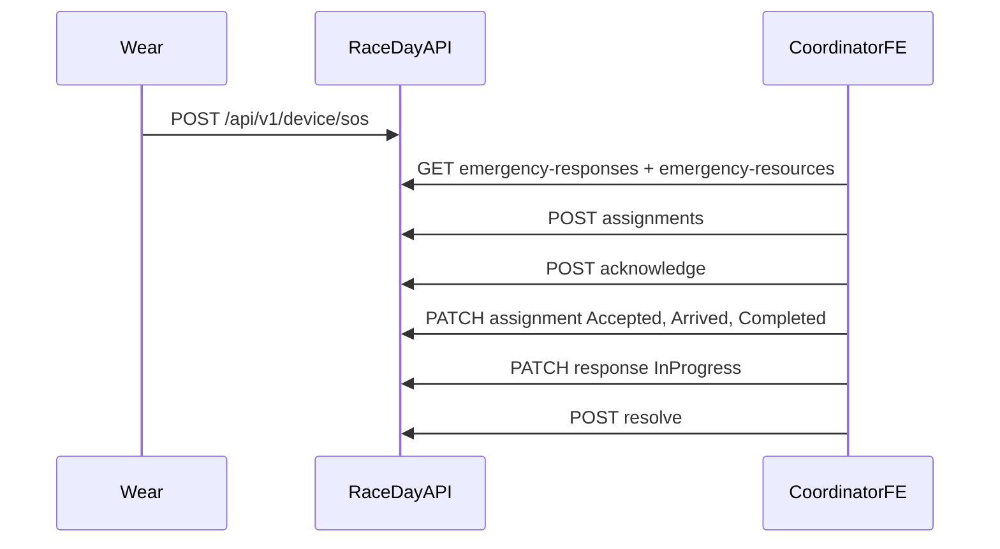

# RaceMonitoring API — theo luồng nghiệp vụ (khớp FE)

> **Trạng thái tài liệu**
>
> - `docs/RaceMonitoring_API_Guide.docx` = bản Word sync từ file này (`python docs/_race_monitoring_md_to_docx.py`, hoặc `powershell -File docs/_race_monitoring_md_to_docx.ps1` khi máy không có Python).
> - Nguồn đúng theo code hiện tại của module RaceMonitoring (`/api/v1/race-monitoring`).
> - Base URL local: `http://localhost:5080` (gateway). JSON **camelCase**.
> - Auth: header `Authorization: Bearer <accessToken>` từ login IAM. Không đưa JWT lên query string.
> - Lỗi validation/domain → HTTP **400** body `{ "error": "…" }` (nhiều message nối bằng `; `).
> - Sai role hoặc token Wear → HTTP **403**. Thiếu/hết hạn JWT → **401**.

Seed demo: `admin@raceday.vn` / `cuong.le@raceday.vn` / `binh.tran@raceday.vn` — mật khẩu `MatKhau@123`.  
Flagship: **VnExpress Marathon Quy Nhon 2026** id `11111111-aaaa-4aaa-8aaa-aaaaaaaaaaa1`.

Module này phục vụ **bàn điều phối** (chủ giải hoặc Coordinator Active), không phải app VĐV và không phải đồng hồ Wear.

---

## 0. Convention lỗi

| HTTP | Khi nào | Body | FE |
|------|---------|------|----|
| 400 | FluentValidation, DomainException, trùng unique | `{ "error": "…" }` | Hiện message. Không redirect. |
| 401 | Thiếu hoặc JWT không hợp lệ | — | Về login |
| 403 | Role không phải Admin / Organizer / Coordinator, hoặc token Wear (`token_use=wear`) | — | `/403` |
| 429 | Quá 400 request/phút trên nhóm authenticated | — | Thử lại |

Không có quyền trên **đúng giải** vẫn là **400**, không phải 403. Ví dụ: Organizer của giải khác gọi timeline → `{ "error": "Chỉ chủ giải hoặc Coordinator Active mới xem timeline." }`.

```json
{ "error": "Chỉ hồ sơ đang mở mới được phân công nguồn lực." }
```

```json
{ "error": "Mã lượt quét không hợp lệ.; Phương thức quét không hợp lệ." }
```

Phân trang dùng chung: query `page` (mặc định 1) và `pageSize` (mặc định 20, tối đa 100). `page < 1` được đưa về 1. `pageSize` ngoài 1–100 được đưa về 20. Body trả về:

```json
{ "items": [], "total": 0, "page": 1, "pageSize": 20 }
```

Enum trên query và body là **tên** (`InProgress`, `Manual`), không phải số `0`/`1`. Không phân biệt hoa thường.

`GET /api/v1/race-monitoring/health` không cần JWT. Response: `{ "module": "race-monitoring", "status": "ready" }`.

---

## 1. Hai lớp quyền

Mọi route ngoài `/health` đều qua policy `OrganizerOrCoordinator`: đã đăng nhập, không phải token Wear, role **Admin**, **Organizer** hoặc **Coordinator**.

Handler kiểm tra tiếp theo giải. Admin **không** được đi tắt ở timeline, checkpoint, nguồn lực và phân công.

| Nhóm API | Ai xử lý được đúng giải |
|----------|-------------------------|
| Xem / acknowledge / sửa tiến độ / resolve hồ sơ SOS | Admin, hoặc chủ giải, hoặc Coordinator Active trên giải đó |
| Hủy hồ sơ, nguồn lực, phân công | Chủ giải hoặc Coordinator Active. Admin không đi tắt |
| Ghi scan, demo scan, xem timeline, SSE | Chủ giải hoặc Coordinator Active. Admin không đi tắt |

Coordinator phải là staff role `Coordinator` và status `Active` trên đúng giải. Volunteer và photographer không gọi được các API này.

SOS nguồn thuộc Device. RaceMonitoring **không** acknowledge, resolve hay hủy SOS đó.

---

## 2. Happy path

### 2.1 Bàn ứng cứu

Hồ sơ phản hồi **không có POST tạo**. Wear gọi `POST /api/v1/device/sos` thì server tự mở một `EmergencyResponse` trạng thái `Open`. FE điều phối chỉ đọc và xử lý hồ sơ đã có.

```text
[Watch] POST /api/v1/device/sos
[Staff] GET  /events/{eventId}/emergency-responses
[Staff] GET  /events/{eventId}/emergency-resources
[Staff] POST /emergency-responses/{id}/assignments     (chỉ khi hồ sơ còn Open)
[Staff] POST /emergency-responses/{id}/acknowledge     Open → Assigned
[Staff] PATCH /emergency-assignments/{id}              Assigned → Accepted → Arrived → Completed
[Staff] PATCH /emergency-responses/{id}                Assigned → InProgress, và/hoặc đổi priority
[Staff] POST /emergency-responses/{id}/resolve         Assigned hoặc InProgress → Resolved
```

Hủy thay cho resolve:

```text
POST /emergency-responses/{id}/cancel
  Open | Assigned | InProgress → Cancelled
  mọi phân công của hồ sơ → Completed
```

`acknowledge` chỉ đổi trạng thái hồ sơ sang `Assigned`. Nó **không** tạo dòng phân công. Phân công là `POST .../assignments`.



Trạng thái hồ sơ:

| Từ | API | Sang |
|----|-----|------|
| Open | POST acknowledge | Assigned |
| Open | POST assignments / DELETE assignment | vẫn Open |
| Assigned | PATCH `{ "status": "InProgress" }` | InProgress |
| Assigned hoặc InProgress | PATCH chỉ `{ "priority" }` | giữ nguyên status, đổi priority |
| Assigned hoặc InProgress | POST resolve | Resolved |
| Open, Assigned, InProgress | POST cancel | Cancelled |

Resolved và Cancelled không sửa tiếp. PATCH tiến độ khi hồ sơ còn Open trả `Không thể cập nhật tiến độ ở trạng thái hiện tại.`

Trạng thái phân công, từng bước một:

`Assigned` → `Accepted` → `Arrived` → `Completed`.

Nhảy bước hoặc gửi lại bước hiện tại trả `Không thể chuyển phân công ở trạng thái hiện tại.` Enum có `Cancelled` nhưng API không nhận status đó. Khi hủy hồ sơ, phân công chưa xong cũng thành `Completed`.

### 2.2 Timeline checkpoint

```text
[Staff] GET  /api/v1/event/organizer/{eventId}/registrations
           lấy registrationId của VĐV Confirmed hoặc Finished, đã có bibNumber
[Staff] POST /api/v1/race-monitoring/events/{eventId}/checkpoint-scans
[Staff] GET  /events/{eventId}/race-logs          lịch sử
[Staff] GET  /events/{eventId}/race-logs/stream   SSE, sau khi đã có lịch sử hoặc song song
```

Một `scanId` mới + đăng ký hợp lệ → `outcome: "Accepted"` và một dòng `RunnerCheckpointPassed`. Gửi lại cùng `scanId` → `200` với `outcome: "Duplicate"`, không thêm log, không bắn SSE lần hai. Đăng ký sai giải, chưa confirmed, chưa có BIB, hoặc checkpoint không thuộc cự ly → **400** và không lưu scan.

VĐV được qua cùng checkpoint nhiều lần. Mỗi lần là một `scanId` mới.

`POST .../checkpoint-scans/demo` chỉ để bàn demo: server tự rút VĐV và checkpoint có thật. Log tạo ra là log thật, hiện trên REST và SSE, không xóa được.

---

## 3. Danh sách endpoint

Prefix: `/api/v1/race-monitoring`.

| Method | Path | Việc FE dùng |
|--------|------|----------------|
| GET | `/health` | Probe module. Không JWT |
| GET | `/events/{eventId}/emergency-responses` | Danh sách hồ sơ SOS của giải |
| GET | `/emergency-responses/{id}` | Chi tiết một hồ sơ |
| POST | `/emergency-responses/{id}/acknowledge` | Open → Assigned |
| PATCH | `/emergency-responses/{id}` | Đổi priority và/hoặc sang InProgress |
| POST | `/emergency-responses/{id}/resolve` | Kết thúc, bắt buộc ghi chú |
| POST | `/emergency-responses/{id}/cancel` | Hủy, bắt buộc lý do |
| GET | `/events/{eventId}/emergency-resources` | Danh sách nguồn lực của giải |
| GET | `/emergency-resources/{id}` | Chi tiết nguồn lực |
| GET | `/emergency-responses/{responseId}/assignments` | Phân công của một hồ sơ |
| POST | `/emergency-responses/{responseId}/assignments` | Gắn nguồn lực khi hồ sơ còn Open |
| DELETE | `/emergency-responses/{responseId}/assignments/{assignmentId}` | Gỡ phân công khi hồ sơ còn Open. `204` |
| GET | `/emergency-assignments/{assignmentId}` | Chi tiết phân công |
| PATCH | `/emergency-assignments/{assignmentId}` | Accepted / Arrived / Completed |
| POST | `/events/{eventId}/checkpoint-scans` | Ghi một lượt qua checkpoint |
| POST | `/events/{eventId}/checkpoint-scans/demo` | Sinh 1–20 lượt demo từ dữ liệu thật |
| GET | `/events/{eventId}/race-logs` | Timeline có phân trang |
| GET | `/events/{eventId}/race-logs/{logId}` | Một dòng timeline |
| GET | `/events/{eventId}/race-logs/stream` | SSE |

Không có POST/PUT/DELETE `race-logs`. Không có API tạo hoặc sửa nguồn lực. Không có API tạo hồ sơ SOS trong module này.

---

## 4. Hồ sơ phản hồi khẩn cấp

### 4.1 `GET /events/{eventId}/emergency-responses`

Query: `status`, `priority`, `incidentType`, `page`, `pageSize`. Bỏ query là không lọc field đó.

| Query | Giá trị |
|-------|---------|
| status | `Open` `Assigned` `InProgress` `Resolved` `Cancelled` |
| priority | `Low` `Medium` `High` `Critical` |
| incidentType | `Medical` `Trauma` `Cardiac` `Heat` `Other` |

Response `200`:

```json
{
  "items": [
    {
      "id": "aaaaaaaa-aaaa-4aaa-8aaa-aaaaaaaaaaaa",
      "sourceSosAlertId": "bbbbbbbb-bbbb-4bbb-8bbb-bbbbbbbbbbbb",
      "eventId": "11111111-aaaa-4aaa-8aaa-aaaaaaaaaaa1",
      "sourceSosStatus": "Open",
      "incidentType": "Medical",
      "priority": "High",
      "status": "Open",
      "assignedAtUtc": null,
      "resolvedAtUtc": null,
      "resolutionNotes": null,
      "cancelledAtUtc": null,
      "cancellationReason": null
    }
  ],
  "total": 1,
  "page": 1,
  "pageSize": 20
}
```

`sourceSosStatus` là trạng thái SOS bên Device, chỉ để hiển thị. Đổi nó bằng API Device, không bằng API này.

Giải không có SOS → `items: []`, `total: 0`, vẫn `200`.

### 4.2 `GET /emergency-responses/{id}`

Cùng shape một object, không bọc `items`. Không trả hồ sơ y tế VĐV. Không thấy hồ sơ: `Không tìm thấy phản hồi khẩn cấp.`

### 4.3 `POST /emergency-responses/{id}/acknowledge`

Không body. `200` trả hồ sơ sau khi `status = "Assigned"` và `assignedAtUtc` có giá trị. Chỉ từ `Open`. Lỗi: `Chỉ phản hồi đang mở mới được xác nhận.`

### 4.4 `PATCH /emergency-responses/{id}`

Phải có ít nhất một field.

```json
{ "priority": "Critical", "status": "InProgress" }
```

| Field | Bắt buộc | Hướng dẫn |
|-------|----------|-----------|
| priority | một trong hai | `Low` `Medium` `High` `Critical`. Đổi được khi hồ sơ đang Assigned hoặc InProgress |
| status | một trong hai | Chỉ giá trị `InProgress`, và chỉ khi hồ sơ đang Assigned |

### 4.5 `POST /emergency-responses/{id}/resolve`

```json
{ "resolutionNotes": "Đã chuyển viện, VĐV ổn định." }
```

`resolutionNotes` không được trống. Chỉ từ Assigned hoặc InProgress. Không gọi resolve SOS thiết bị.

### 4.6 `POST /emergency-responses/{id}/cancel`

```json
{ "reason": "SOS bấm nhầm, VĐV tiếp tục chạy." }
```

`reason` không được trống. Từ Open, Assigned hoặc InProgress. Mọi phân công của hồ sơ chuyển `Completed`. SOS thiết bị giữ nguyên.

Quyền hủy hẹp hơn acknowledge: Admin không đi tắt. Lỗi: `Chỉ organizer của giải hoặc Coordinator Active mới điều phối nguồn lực.`

---

## 5. Nguồn lực

Chỉ đọc. Danh sách là dữ liệu đã có trên giải (seed hoặc dữ liệu vận hành), không có API tạo xe / đội y tế từ FE.

### 5.1 `GET /events/{eventId}/emergency-resources`

Query: `status`, `resourceType`, `page`, `pageSize`.

| Query | Giá trị |
|-------|---------|
| status | `Available` `Assigned` `Unavailable` `Offline` |
| resourceType | `MedicalTeam` `Ambulance` `FirstAid` `Other` |

```json
{
  "items": [
    {
      "id": "cccccccc-cccc-4ccc-8ccc-cccccccccccc",
      "eventId": "11111111-aaaa-4aaa-8aaa-aaaaaaaaaaa1",
      "resourceCode": "AMB-01",
      "resourceType": "Ambulance",
      "name": "Xe cứu thương km 5",
      "status": "Available",
      "notes": null
    }
  ],
  "total": 1,
  "page": 1,
  "pageSize": 20
}
```

Gán nguồn lực vào hồ sơ **không** đổi `status` của nguồn lực. `Unavailable` và `Offline` không phân công được.

### 5.2 `GET /emergency-resources/{id}`

Cùng một object. Nguồn lực không gắn giải: `Nguồn lực không thuộc giải.`

---

## 6. Phân công

### 6.1 `GET /emergency-responses/{responseId}/assignments`

Query `page`, `pageSize`.

```json
{
  "items": [
    {
      "id": "dddddddd-dddd-4ddd-8ddd-dddddddddddd",
      "emergencyResponseId": "aaaaaaaa-aaaa-4aaa-8aaa-aaaaaaaaaaaa",
      "emergencyResourceId": "cccccccc-cccc-4ccc-8ccc-cccccccccccc",
      "resourceCode": "AMB-01",
      "resourceName": "Xe cứu thương km 5",
      "resourceType": "Ambulance",
      "resourceStatus": "Available",
      "assignedAtUtc": "2026-10-27T14:00:00Z",
      "acceptedAtUtc": null,
      "arrivedAtUtc": null,
      "completedAtUtc": null,
      "status": "Assigned",
      "notes": "Ưu tiên km 5"
    }
  ],
  "total": 1,
  "page": 1,
  "pageSize": 20
}
```

### 6.2 `POST /emergency-responses/{responseId}/assignments`

```json
{
  "emergencyResourceId": "cccccccc-cccc-4ccc-8ccc-cccccccccccc",
  "notes": "Ưu tiên km 5"
}
```

| Field | Bắt buộc | Hướng dẫn |
|-------|----------|-----------|
| emergencyResourceId | ✓ | Guid nguồn lực cùng giải, không Unavailable/Offline |
| notes | | Trống thì lưu null |

`200` trả một `EmergencyAssignment` như item ở trên, `status: "Assigned"`. Hồ sơ phải còn `Open`. Cùng nguồn lực trên cùng hồ sơ: `Nguồn lực này đã nằm trong danh sách phân công của hồ sơ.`

### 6.3 `DELETE /emergency-responses/{responseId}/assignments/{assignmentId}`

Không body. `204` không body. Chỉ khi hồ sơ còn `Open` và `assignmentId` thuộc đúng hồ sơ. Sau acknowledge thì không gỡ được.

### 6.4 `GET /emergency-assignments/{assignmentId}`

Một object, cùng field với item danh sách.

### 6.5 `PATCH /emergency-assignments/{assignmentId}`

```json
{ "status": "Accepted" }
```

Gọi ba lần, đúng thứ tự: `Accepted`, rồi `Arrived`, rồi `Completed`. Mỗi lần server ghi mốc tương ứng `acceptedAtUtc`, `arrivedAtUtc`, `completedAtUtc`. Không gửi `Assigned` hay `Cancelled`. Hồ sơ đã Resolved hoặc Cancelled: `Không thể cập nhật phân công khi hồ sơ đã kết thúc.`

---

## 7. Ghi checkpoint

### 7.1 Nguồn id

| Field scan | Lấy từ đâu |
|------------|------------|
| eventId | Id giải |
| registrationId | `id` trong `GET /api/v1/event/organizer/{eventId}/registrations` |
| scanId | FE tự sinh UUID mỗi lượt bấm. Giữ lại để retry an toàn |
| scannedAtUtc | ISO-8601 UTC, ví dụ `2026-10-27T14:05:00Z` |
| checkpointId | Guid khóa chính bảng checkpoint của cự ly (**không** phải `id` chuỗi trên course map) |

Đăng ký phải `Confirmed` hoặc `Finished` và có `bibNumber`. BIB không gửi trong body scan; server đọc từ đăng ký.

`GET /api/v1/map/events/{eventId}/distances/{distanceId}/course` trả `checkpoints[].id` là chuỗi (id trên bản đồ). API scan không nhận chuỗi đó. `distances[].checkpoints` trên hồ sơ giải công khai hiện đang là mảng rỗng. Chưa có API RaceMonitoring liệt kê Guid checkpoint. Màn hình ghi tay cần Guid `event_checkpoints` thì chưa ghép được từ course map; dùng `POST .../checkpoint-scans/demo` khi chỉ cần thấy timeline chạy trên dữ liệu seed.

### 7.2 `POST /events/{eventId}/checkpoint-scans`

Chủ giải hoặc Coordinator Active.

```json
{
  "scanId": "3fa85f64-5717-4562-b3fc-2c963f66afa6",
  "registrationId": "eeeeeeee-eeee-4eee-8eee-eeeeeeeeeeee",
  "checkpointId": "ffffffff-ffff-4fff-8fff-ffffffffffff",
  "scanMethod": "Manual",
  "scannedAtUtc": "2026-10-27T14:05:00Z"
}
```

| Field | Bắt buộc | Hướng dẫn |
|-------|----------|-----------|
| scanId | ✓ | UUID. Trùng thì Duplicate |
| registrationId | ✓ | Đăng ký của đúng giải |
| checkpointId | ✓ | Checkpoint của đúng cự ly đăng ký |
| scanMethod | ✓ | `RFID` hoặc `Manual`. Số `"0"` bị từ chối |
| scannedAtUtc | ✓ | Khác `0001-01-01`. Kind local được đổi sang UTC |

Accepted `200`:

```json
{
  "outcome": "Accepted",
  "scanId": "3fa85f64-5717-4562-b3fc-2c963f66afa6",
  "raceEventLogId": "99999999-9999-4999-8999-999999999999",
  "sequence": 42,
  "eventId": "11111111-aaaa-4aaa-8aaa-aaaaaaaaaaa1"
}
```

Duplicate cũng `200`. `raceEventLogId` và `sequence` là dòng đã ghi lần đầu, có thể null nếu không tìm thấy log nguồn.

```json
{
  "outcome": "Duplicate",
  "scanId": "3fa85f64-5717-4562-b3fc-2c963f66afa6",
  "raceEventLogId": "99999999-9999-4999-8999-999999999999",
  "sequence": 42,
  "eventId": "11111111-aaaa-4aaa-8aaa-aaaaaaaaaaa1"
}
```

Lỗi thường gặp, đều 400, không tạo dòng:

| Tình huống | `error` |
|------------|---------|
| Đăng ký không thuộc giải | Đăng ký không thuộc giải này. |
| Chưa Confirmed/Finished | Chỉ VĐV confirmed hoặc finished mới ghi nhận qua checkpoint. |
| Chưa có BIB | Đăng ký chưa có số BIB. |
| Checkpoint khác cự ly | Checkpoint không thuộc cự ly của VĐV. |
| scanMethod sai | Phương thức quét không hợp lệ. |

SSE chỉ phát sau khi commit thành công. Lỗi phát stream không làm mất log đã ghi; response vẫn `Accepted`.

### 7.3 `POST /events/{eventId}/checkpoint-scans/demo`

Cùng quyền ghi scan. Body có thể bỏ, hoặc:

```json
{ "count": 5 }
```

`count` từ 1 đến 20. Bỏ trống hoặc nằm ngoài khoảng thì server dùng 5. Mỗi dòng là một transaction, `scanId` mới, `scanMethod` ngẫu nhiên `RFID` hoặc `Manual`, thời điểm trong quá khứ và tăng 1 giây mỗi dòng.

```json
{
  "eventId": "11111111-aaaa-4aaa-8aaa-aaaaaaaaaaa1",
  "requested": 5,
  "accepted": 5,
  "items": [
    {
      "outcome": "Accepted",
      "scanId": "…",
      "raceEventLogId": "…",
      "sequence": 43,
      "eventId": "11111111-aaaa-4aaa-8aaa-aaaaaaaaaaa1"
    }
  ]
}
```

Giải chưa có VĐV confirmed có BIB và checkpoint đúng cự ly: `Giải chưa có VĐV confirmed có BIB và checkpoint trên đúng cự ly.`

Không gọi API này trên giải thật nếu không muốn timeline dính dữ liệu demo. Không có cờ xóa.

---

## 8. Timeline REST

Chủ giải hoặc Coordinator Active. Admin không đi tắt.

### 8.1 `GET /events/{eventId}/race-logs`

| Query | Hướng dẫn |
|-------|-----------|
| eventDistanceId | Guid cự ly |
| eventType | `RunnerCheckpointPassed` hoặc `RaceStarted` |
| bibNumber | So khớp không phân biệt hoa thường |
| fromUtc, toUtc | Lọc `occurredAtUtc` |
| afterSequence | Chỉ dòng có `sequence` lớn hơn giá trị này |
| page, pageSize | Như convention |

Thứ tự: `occurredAtUtc` rồi `sequence`.

```json
{
  "items": [
    {
      "id": "99999999-9999-4999-8999-999999999999",
      "sequence": 42,
      "eventId": "11111111-aaaa-4aaa-8aaa-aaaaaaaaaaa1",
      "eventDistanceId": "22222222-bbbb-4bbb-8bbb-bbbbbbbbbbb1",
      "eventType": "RunnerCheckpointPassed",
      "occurredAtUtc": "2026-10-27T14:05:00Z",
      "recordedAtUtc": "2026-10-27T14:05:01Z",
      "bibNumber": "1024",
      "checkpointId": "ffffffff-ffff-4fff-8fff-ffffffffffff",
      "registrationId": "eeeeeeee-eeee-4eee-8eee-eeeeeeeeeeee",
      "sourceType": "CheckpointScan",
      "sourceId": "3fa85f64-5717-4562-b3fc-2c963f66afa6",
      "scanMethod": "Manual"
    }
  ],
  "total": 1,
  "page": 1,
  "pageSize": 20
}
```

`sequence` là số tăng của database, dùng làm `Last-Event-ID`. `id` là Guid để khử trùng. `RaceStarted` có trong enum nhưng hiện không có API nào ghi dòng đó, nên list thực tế chỉ thấy `RunnerCheckpointPassed` cho đến khi có nghiệp vụ xuất phát.

`eventType` sai: `Loại sự kiện timeline không hợp lệ.`

### 8.2 `GET /events/{eventId}/race-logs/{logId}`

Một object cùng field. Log của giải khác hoặc không tồn tại: `Không tìm thấy log.`

Mở màn hình: gọi REST này (hoặc list) để vẽ lịch sử. SSE không gửi lịch sử nếu không có `Last-Event-ID`.

---

## 9. SSE `GET /events/{eventId}/race-logs/stream`

`Content-Type: text/event-stream`. `Cache-Control: no-cache`. JWT trên header `Authorization`. Trình duyệt `EventSource` không gắn được header này — dùng `fetch` và đọc stream.

Không có `Last-Event-ID`: chỉ nhận log ghi **sau** lúc kết nối. Có header `Last-Event-ID: 42`: nhận `sequence > 42`, cộng các dòng `sequence <= 42` nhưng `recordedAtUtc` trong 30 giây gần nhất. Cửa sổ 30 giây có thể gửi lại dòng client đã có. Khử trùng bằng `id`.

Khung log:

```text
id: 42
event: RaceEventLogCreated
data: {"id":"99999999-9999-4999-8999-999999999999","sequence":42,"eventId":"11111111-aaaa-4aaa-8aaa-aaaaaaaaaaa1","eventDistanceId":"22222222-bbbb-4bbb-8bbb-bbbbbbbbbbb1","eventType":"RunnerCheckpointPassed","occurredAtUtc":"2026-10-27T14:05:00Z","recordedAtUtc":"2026-10-27T14:05:01Z","bibNumber":"1024","checkpointId":"ffffffff-ffff-4fff-8fff-ffffffffffff","registrationId":"eeeeeeee-eeee-4eee-8eee-eeeeeeeeeeee","sourceType":"CheckpointScan","sourceId":"3fa85f64-5717-4562-b3fc-2c963f66afa6","scanMethod":"Manual"}

```

Heartbeat mỗi 15 giây, không phải event:

```text
: ping

```

Mỗi heartbeat server kiểm tra lại quyền. Mất quyền thì một frame rồi đóng:

```text
event: RaceEventLogAccessRevoked
data: {"eventId":"11111111-aaaa-4aaa-8aaa-aaaaaaaaaaa1"}

```

Client không đọc kịp (hàng đợi 256): 

```text
event: RaceEventLogStreamOverrun
data: {"eventId":"11111111-aaaa-4aaa-8aaa-aaaaaaaaaaa1"}

```

Sau overrun, đóng stream và nối lại với `Last-Event-ID` bằng sequence cuối đã xử lý, đồng thời kéo REST `afterSequence` nếu cần khoảng trống.

`Last-Event-ID` không phải số ≥ 0: `400` `{ "error": "Last-Event-ID không hợp lệ." }` trước khi stream bắt đầu.

Broker nằm trong một process. Restart API làm rơi subscriber đang nối; client nối lại. Không có Redis. Hai instance API sẽ không thấy SSE của nhau.

Mẫu đọc stream:

```javascript
const res = await fetch(`${base}/api/v1/race-monitoring/events/${eventId}/race-logs/stream`, {
  headers: {
    Authorization: `Bearer ${accessToken}`,
    Accept: "text/event-stream",
    ...(lastSequence != null ? { "Last-Event-ID": String(lastSequence) } : {})
  }
});
const reader = res.body.getReader();
const decoder = new TextDecoder();
// Tách frame theo dòng trống. Bỏ qua dòng bắt đầu bằng ":".
// event RaceEventLogCreated → JSON.parse(data), dedupe bằng id, nhớ sequence.
```

---

## 10. Việc không nằm trong module này

| Việc FE cần | API khác |
|-------------|----------|
| Mở SOS từ đồng hồ | `POST /api/v1/device/sos` |
| Danh sách / ack SOS thiết bị | Device, không phải RaceMonitoring |
| Danh sách VĐV và BIB | `GET /api/v1/event/organizer/{eventId}/registrations` |
| Course bản đồ | `GET /api/v1/map/events/{eventId}/distances/{distanceId}/course` — `checkpoints[].id` là chuỗi, không đưa vào scan |
| Xuất phát cả cự ly (`RaceStarted`) | Chưa có |
| Sửa hoặc xóa một dòng timeline | Không có |
| Tạo nguồn lực cấp cứu | Không có trên API này |
