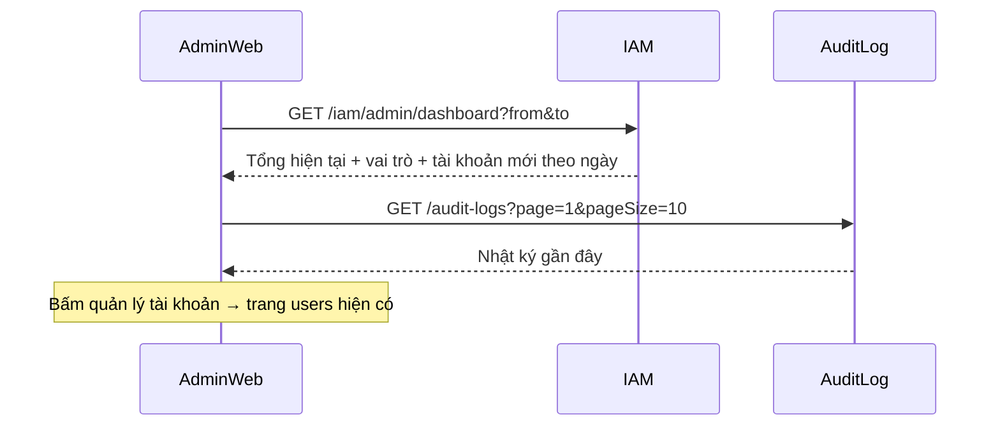
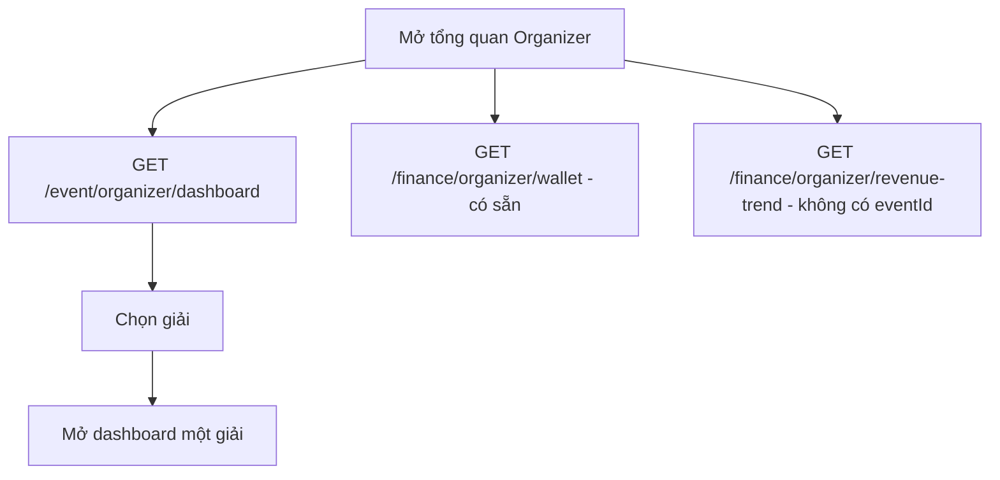

# Dashboard Admin và Organizer

Tài liệu cho 5 API dashboard trong WebAPI. Phạm vi: Admin quản trị tài khoản và Organizer quản lý các giải của mình; không bao gồm dashboard Manager. Đã tích hợp giao diện AdminWeb/UserWeb; xem [luồng dashboard và hướng dẫn sử dụng](dashboard-ui.md).

## 1. Danh sách API

Ngoài 5 API JSON dưới đây, có 3 API xuất dashboard Excel/PDF. Xem [luồng xuất, tham số và quyền truy cập](dashboard-export.md).

| Method | Đường dẫn | Mục đích |
| --- | --- | --- |
| GET | `/api/v1/iam/admin/dashboard?from=&to=` | Tài khoản hiện tại, phân bố vai trò và tài khoản mới theo ngày |
| GET | `/api/v1/event/organizer/dashboard` | Các giải của tôi, việc chờ xử lý và giải sắp diễn ra |
| GET | `/api/v1/event/organizer/{eventId}/dashboard` | Đăng ký, check-in, thi đấu, sức chứa và chuẩn bị một giải |
| GET | `/api/v1/event/organizer/{eventId}/dashboard/registrations-trend?from=&to=` | Đơn đăng ký được tạo theo ngày và cự ly |
| GET | `/api/v1/finance/organizer/revenue-trend?eventId=&from=&to=` | Tiền vé đã thu/đã hoàn theo ngày, một giải hoặc tất cả giải của tôi |

Không cần migration: API chỉ đọc dữ liệu hiện có, không tạo bảng dashboard, không thay đổi trạng thái giải hay thanh toán.

## 2. Xác thực, phạm vi dữ liệu và ngày thống kê

- Gửi `Authorization: Bearer <accessToken>`; frontend sử dụng BFF/auth flow sẵn có.
- Admin: policy `AdminOnly`, handler cũng kiểm tra Admin.
- Organizer: `PublicUser` + `HumanUser`, không chấp nhận token đồng hồ. Kiểm tra quyền bằng `OrganizerUserId` của giải, không chỉ dựa vào tên role.
- Các API Organizer mới không có ngoại lệ cho Admin/Manager xem giải của người khác. Truy vấn tổng quan chỉ trả giải của tài khoản hiện tại.
- Không tồn tại giải và không sở hữu giải trả cùng thông báo, tránh tiết lộ dữ liệu của Organizer khác.
- `from`, `to`: ngày ISO `yyyy-MM-dd`, bao gồm cả hai ngày. Múi giờ hiển thị `Asia/Ho_Chi_Minh` (UTC+7).
- Bỏ cả hai: 30 ngày, kết thúc hôm nay theo giờ Việt Nam. Chỉ có `to`: 30 ngày kết thúc ngày đó. Chỉ có `from`: từ ngày đó đến hôm nay.
- Khoảng ngày tối đa 366 ngày; `from <= to`; năm được nhận 1900–9998. Sai định dạng bị từ chối khi bind request.
- Backend chuyển ngày sang khoảng UTC nửa mở `[fromUtc, toUtcExclusive)` trước khi lọc. Ví dụ ngày 15/11/2026 tương ứng `[2026-11-14T17:00:00Z, 2026-11-15T17:00:00Z)`.
- Biểu đồ luôn có đủ ngày, tăng dần; ngày không có dữ liệu trả số 0.
- `generatedAtUtc` là thời điểm hoàn tất phản hồi. Dữ liệu được đọc qua nhiều truy vấn; không cam kết snapshot giao dịch chung khi có cập nhật đồng thời.
- Hai API tổng quan Organizer không nhận `from/to`: trả trạng thái hiện tại. Bộ lọc ngày chỉ dành cho biểu đồ.

### Lỗi

| HTTP | Trường hợp |
| --- | --- |
| 401 | Chưa xác thực/token không hợp lệ |
| 403 | Không đạt policy, ví dụ Runner gọi dashboard Admin hoặc token đồng hồ gọi dashboard Organizer |
| 400 | Ngày sai định dạng, khoảng ngày không hợp lệ; giải không tồn tại/không thuộc người gọi |
| 429 | Vượt rate limit của nhóm API hiện có |

Lỗi nghiệp vụ theo middleware hiện tại: `{ "error": "Không tìm thấy giải thuộc quyền quản lý của bạn." }`. Lỗi bind ngày có thể theo phản hồi mặc định ASP.NET. Khi lỗi, frontend hiển thị lỗi và nút thử lại; không đổi thành số 0 như dữ liệu rỗng.

## 3. Luồng màn hình Admin



Hai request độc lập có thể gọi song song. Đổi khoảng ngày chỉ cần tải lại dashboard IAM.

Ví dụ phản hồi **minh họa**, không phải số liệu thực:

```json
{
  "totalUsers": 3,
  "activeUsers": 1,
  "pendingUsers": 1,
  "lockedUsers": 1,
  "newUsersInPeriod": 1,
  "usersByRole": [
    { "role": "Organizer", "count": 1 },
    { "role": "Runner", "count": 2 }
  ],
  "newUsersByDay": [
    { "date": "2026-11-15", "count": 1 },
    { "date": "2026-11-16", "count": 0 }
  ],
  "from": "2026-11-15",
  "to": "2026-11-16",
  "timeZone": "Asia/Ho_Chi_Minh",
  "generatedAtUtc": "2026-11-16T03:00:00Z"
}
```

- `totalUsers`, `activeUsers`, `pendingUsers`, `lockedUsers`, `usersByRole`: trạng thái hiện tại, không lọc theo `from/to`.
- `activeUsers` là tài khoản có trạng thái Active, **không phải đang online**.
- `newUsersInPeriod` và `newUsersByDay`: lọc theo `User.CreatedAt`, không theo lần đăng nhập. Tổng các ngày bằng `newUsersInPeriod`.
- `usersByRole` chỉ liệt kê vai trò có tài khoản; không dùng API quản trị tài khoản này cho Manager.

## 4. Luồng tổng quan Organizer



`GET /api/v1/event/organizer/dashboard` trả:

| Trường | Ý nghĩa |
| --- | --- |
| `totalEvents` | Tổng số giải thuộc người gọi, gồm cả nháp/hủy |
| `eventsByStatus[]` | `{ status, count }`, đủ các trạng thái enum hiện tại kể cả count = 0; dùng mã trạng thái API sẵn có |
| `pendingRegistrations` | Tổng đăng ký `PendingApproval` của các giải thuộc người gọi |
| `pendingComplaints` | Tổng khiếu nại Event có trạng thái `Pending` |
| `upcomingEvents[]` | Tối đa 5 giải, ngày tổ chức từ hôm nay (giờ Việt Nam), trạng thái Approved/RegistrationOpen/Closed; tăng dần theo ngày |
| `eventsWithPendingTasks[]` | Các giải có đăng ký hoặc khiếu nại chờ xử lý; giảm dần theo số việc |
| `generatedAtUtc` | Thời điểm phản hồi |

Mỗi phần tử danh sách giải gồm `eventId`, `name`, `status`, `eventDate`, `pendingRegistrations`, `pendingComplaints`, `pendingTasks`. `pendingTasks` = hai số chờ xử lý cộng lại; **không bao gồm** hồ sơ thiếu, payout, khiếu nại ảnh hoặc tranh chấp kết quả. Tránh gắn nhãn là toàn bộ mọi việc trên hệ thống.

Organizer chưa có giải nhận các tổng bằng 0, danh sách giải rỗng. Tiền ví lấy từ Finance hiện có; không cộng số đăng ký với giá vé để suy ra doanh thu.

## 5. Luồng dashboard một giải

Sau khi chọn giải, frontend có thể gọi song song:

```text
GET /api/v1/event/{eventId}                                      → tên, ngày, địa điểm… (có sẵn)
GET /api/v1/event/organizer/{eventId}/dashboard                  → KPI hiện tại, chuẩn bị
GET /api/v1/event/organizer/{eventId}/dashboard/registrations-trend?from=2026-11-01&to=2026-11-30
GET /api/v1/finance/organizer/events/{eventId}/summary             → tiền của giải (có sẵn)
GET /api/v1/finance/organizer/revenue-trend?eventId={eventId}&from=2026-11-01&to=2026-11-30
```

### Phản hồi tổng quan một giải

| Trường | Ý nghĩa và cách dùng |
| --- | --- |
| `eventId` | Giải đang xem |
| `totalRegistrations` | Tổng bản ghi đăng ký, kể cả hủy/từ chối; không phải số người duy nhất |
| `registrationsByStatus[]` | `{ status, count }` cho `pending_payment`, `pending_approval`, `confirmed`, `finished`, `rejected`, `cancelled` |
| `checkInSummary.eligible` | Đăng ký hiện có status Confirmed hoặc Finished |
| `checkInSummary.checkedIn` | Trong nhóm eligible, có `CheckedInAtUtc` |
| `raceByStatus[]` | `{ status, count }` cho `not_started`, `running`, `finished`, `dns`, `dnf`, `dq`; chỉ tính nhóm eligible |
| `pendingComplaints` | Khiếu nại Event còn Pending của giải |
| `distances[]` | Sức chứa và số đăng ký của từng cự ly |
| `preparation` | Các dữ kiện chuẩn bị giải, mô tả bên dưới |
| `generatedAtUtc` | Thời điểm phản hồi |

`registrationsByStatus.confirmed` chỉ là trạng thái đăng ký Confirmed. VĐV đã finish được đếm ở `finished`; vì vậy dùng `checkInSummary.eligible` khi muốn tổng đăng ký đã được xác nhận, gồm người đã hoàn thành. Nhóm đăng ký và nhóm thi đấu là hai cách nhìn khác nhau, **không cộng hai nhóm**.

Mỗi phần tử `distances`:

```json
{
  "distanceId": "22222222-bbbb-4bbb-8bbb-bbbbbbbbbbb1",
  "name": "5 km",
  "capacity": 100,
  "reservedSlots": 70,
  "confirmedRegistrations": 50
}
```

- `reservedSlots` lấy từ `EventDistance.RegisteredCount`, tức bộ đếm chỗ đang sử dụng/giữ của hệ thống, không phải vé đã thanh toán. Có thể chờ job xử lý hold hết hạn để cập nhật.
- `confirmedRegistrations` đếm Confirmed + Finished của cự ly.
- `capacity <= 0` theo domain là không giới hạn; không chia để tính % lấp đầy.
- Các tỷ lệ có mẫu số 0 phải hiển thị trạng thái chưa có dữ liệu, không chia cho 0.

`preparation`:

| Trường | Cách tính |
| --- | --- |
| `totalDistances` | Số cự ly hiện có |
| `distancesWithBib` | Số cự ly có cấu hình BIB theo `HasBibRange` |
| `missingDocumentKeys[]` | Thiếu `official-letter`, `security` hoặc tài liệu đánh dấu Required; coi đã có khi FileName hoặc FileUrl có giá trị, khớp quy tắc domain hiện tại |
| `coursesReady` | Số cự ly có route trong module Map với ít nhất 2 điểm polyline |
| `coursesWithCheckpoints` | Trong các route sẵn có, số cự ly có ít nhất 1 checkpoint |
| `activeStaff` | Số bản ghi nhân sự trạng thái Active |
| `assignedStaff` | Trong Active, số bản ghi có StationId chính |

Các số chuẩn bị là dữ kiện để dẫn người dùng tới màn hình tương ứng, **không phải kết luận đủ điều kiện gửi duyệt/mở đăng ký**. Không suy diễn có một nhân sự hay một checkpoint là đủ yêu cầu vận hành của giải.

### Biểu đồ đăng ký

`registrations-trend` trả `eventId`, `from`, `to`, `timeZone`, `totalRegistrations`, `days[]`, `distances[]`, `generatedAtUtc`.

```json
{
  "eventId": "11111111-aaaa-4aaa-8aaa-aaaaaaaaaaa1",
  "from": "2026-11-15",
  "to": "2026-11-16",
  "timeZone": "Asia/Ho_Chi_Minh",
  "totalRegistrations": 2,
  "days": [{ "date": "2026-11-15", "count": 2 }, { "date": "2026-11-16", "count": 0 }],
  "distances": [{
    "distanceId": "22222222-bbbb-4bbb-8bbb-bbbbbbbbbbb1",
    "name": "5 km",
    "days": [{ "date": "2026-11-15", "count": 2 }, { "date": "2026-11-16", "count": 0 }]
  }],
  "generatedAtUtc": "2026-11-16T03:00:00Z"
}
```

Thống kê theo `EventRegistration.CreatedAtUtc`, gồm mọi trạng thái hiện tại, kể cả đơn đã hủy. Đây là lịch sử tạo đơn; không phải số thanh toán, số duyệt theo ngày, hay conversion rate. Thay đổi trạng thái đơn không chuyển đơn sang ngày khác.

## 6. Biểu đồ tiền vé và tiền hoàn

`GET /api/v1/finance/organizer/revenue-trend`

- Có `eventId`: kiểm tra đúng chủ giải rồi lấy các đăng ký của giải.
- Không có `eventId`: lấy đăng ký của tất cả giải thuộc người gọi.
- Event cung cấp scope đăng ký qua contract; Payment tổng hợp dữ liệu của chính module mình. Không đọc DbContext của module khác trong Finance.
- Giữ cả đăng ký đã hủy/hoàn tiền trong scope để không mất lịch sử thu tiền.
- **Tiền thu:** PaymentOrder purpose Registration, status Paid hoặc Refunded; tính Amount một lần trên mỗi payment, theo PaidAtUtc.
- **Tiền hoàn:** PaymentTransaction type `refund`, status Succeeded, theo CreatedAtUtc của giao dịch; không theo ngày tạo yêu cầu hoàn hay UpdatedAt của yêu cầu.
- Không tính đơn Pending/Failed/Cancelled/Expired, giao dịch hoàn thất bại, hoặc tiền mua gói tổ chức.
- Không cộng các loại tiền tệ vào một tổng. Mỗi `series` là một currency; không có giao dịch thì trả series VND đủ ngày với số 0.

```json
{
  "eventId": null,
  "from": "2026-11-15",
  "to": "2026-11-16",
  "timeZone": "Asia/Ho_Chi_Minh",
  "series": [{
    "currency": "VND",
    "totalCollected": 100000,
    "totalRefunded": 50000,
    "netCashFlow": 50000,
    "days": [
      { "date": "2026-11-15", "collected": 100000, "refunded": 0, "netCashFlow": 100000 },
      { "date": "2026-11-16", "collected": 0, "refunded": 50000, "netCashFlow": -50000 }
    ]
  }],
  "generatedAtUtc": "2026-11-16T03:00:00Z"
}
```

`netCashFlow = collected - refunded` trong kỳ, có thể âm. Không phải lợi nhuận, doanh thu nền tảng, số tiền được rút hoặc số dư ví. Payment đã thu trước kỳ và hoàn trong kỳ chỉ góp vào cột refunded của kỳ hiện tại. Dữ liệu cũ thiếu PaidAtUtc hoặc thiếu giao dịch refund thành công không được tự suy đoán thời điểm từ ledger/request; cần kiểm tra dữ liệu nguồn nếu biểu đồ khác ledger.

## 7. Bấm chỉ số để xem chi tiết

| Thao tác UI | API/màn hình chi tiết hiện có |
| --- | --- |
| Admin xem tài khoản | `/api/v1/iam/admin/users?page=&pageSize=` |
| Admin xem nhật ký | `/api/v1/audit-logs?page=&pageSize=` |
| Chọn giải | `/api/v1/event/organizer/mine` |
| Organizer duyệt đăng ký | `/api/v1/event/organizer/{eventId}/registrations` |
| Xem check-in | `/api/v1/event/check-ins?eventId=` |
| Xem khiếu nại | `/api/v1/event/organizer/complaints` (dùng bộ lọc được endpoint hiện có hỗ trợ) |
| Xem giải ngân | `/api/v1/finance/organizer/payouts?eventId=` |
| Xem tiền một giải | `/api/v1/finance/organizer/events/{eventId}/summary` |
| Xem toàn ví | `/api/v1/finance/organizer/wallet` |

Dashboard không thêm thao tác ghi. Các nút duyệt, phản hồi, xin giải ngân tiếp tục dùng flow nghiệp vụ hiện có. Mỗi khối nên có loading/error riêng. Khi đổi giải, hủy/bỏ qua phản hồi của giải cũ để tránh hiển thị nhầm dữ liệu. Khi đổi ngày, tải lại các biểu đồ; KPI hiện tại giữ nguyên ý nghĩa.

## 8. Vị trí code và kiểm tra

- IAM: `Application/Dashboard/AdminDashboardQuery.cs`, `Infrastructure/Repositories/AdminDashboardReader.cs`.
- Event: `Application/Dashboard/OrganizerDashboardQueries.cs`, `Infrastructure/Events/OrganizerDashboardReader.cs`.
- Finance: `Application/Dashboard/RevenueTrendQuery.cs`.
- Payment: `Infrastructure/Finance/PaymentRevenueQuery.cs`.
- Khoảng ngày dùng chung: `Shared/RaceDay.Shared.Application/Dashboard/DashboardDateRange.cs`.
- Test: `tests/RaceDay.Dashboard.Tests`.

```powershell
dotnet test tests/RaceDay.Dashboard.Tests/RaceDay.Dashboard.Tests.csproj
dotnet build src/Hosts/RaceDay.Api/RaceDay.Api.csproj
```

Test dùng database SQLite trong bộ nhớ và mock ở ranh giới module; không sửa dữ liệu phát triển. Bộ test còn kiểm tra binding/policy của 5 route và dịch các truy vấn biểu đồ bằng Npgsql, chặn kết nối/execute thật. Đây không phải kiểm thử trên PostgreSQL đang chạy.

Kết quả kiểm tra khi triển khai: 11 test dashboard, 73 test IAM, 179 test Event, 13 test Finance và 8 test Payment đều qua; build API thành công. Build còn các cảnh báo dependency/phiên bản EF có sẵn trong dự án. Chưa chạy giao diện hoặc luồng đăng nhập trên PostgreSQL thật. Khi tích hợp, kiểm tra thêm đăng nhập thực, request trái quyền và các ngày sát 00:00 giờ Việt Nam. API mới xuất hiện trong Swagger cùng nhóm IAM Admin, Event Organizer và Finance hiện có, có schema phản hồi DTO.
