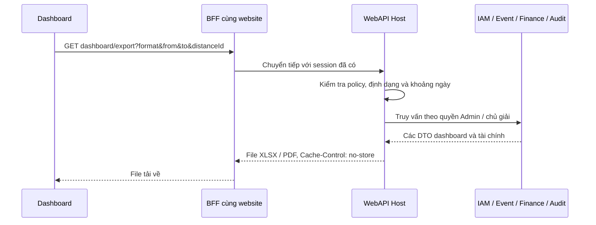

# Dashboard: nhóm trạng thái và xuất báo cáo

## Cách sử dụng

1. Admin vào **Dashboard** ở AdminWeb; Organizer vào **Dashboard** ở UserWeb hoặc tab **Tổng quan** của một giải.
2. Chọn khoảng ngày rồi bấm **Áp dụng**, hoặc chọn nhanh 7/30/90 ngày.
3. Dashboard một giải có thể chọn cự ly tại **Đăng ký mới**. Cự ly chỉ lọc biểu đồ đăng ký; KPI, sức chứa và tài chính vẫn tính toàn giải.
4. Bấm **Xuất Excel** hoặc **Xuất PDF** cạnh bộ lọc/biểu đồ. Hai nút bị khóa trong lúc tạo file.
5. File tải về gồm số liệu hiện tại được đọc lại và biểu đồ theo kỳ đã áp dụng. Nếu lỗi, thông báo hiển thị ngay cạnh nút và có thể bấm lại. Không tạo báo cáo từ dữ liệu mô phỏng.

## API

| GET, tiền tố `/api/v1` | Phạm vi |
| --- | --- |
| `/iam/admin/dashboard/export` | Tài khoản, trạng thái, vai trò, tài khoản mới theo ngày, 6 hoạt động gần đây |
| `/event/organizer/dashboard/export` | Tổng quan các giải, nhóm/chi tiết trạng thái, việc chờ xử lý, lịch sắp tới, ví và dòng tiền |
| `/event/organizer/{eventId}/dashboard/export` | KPI giải, nhóm/chi tiết đăng ký, thi đấu, sức chứa, chuẩn bị, tài chính, đăng ký mới và dòng tiền |

Tham số:

- `format=xlsx|pdf` bắt buộc, chữ thường; giá trị khác trả lỗi 400.
- `from`, `to`: ISO `yyyy-MM-dd`; mặc định 30 ngày theo UTC+7, tối đa 366 ngày như API dashboard.
- `distanceId`: tùy chọn, chỉ API một giải; kiểm tra cự ly thuộc giải, chỉ lọc phần đăng ký mới. Không truyền nghĩa là tất cả cự ly.
- Quyền Admin: `AdminOnly`. Quyền Organizer: `PublicUser` + `HumanUser`, truy vấn Event kiểm tra chủ giải trước khi đọc tài chính; không có ngoại lệ Admin xem giải người khác.
- Chưa đăng nhập: 401. Sai policy: 403. Sai định dạng/ngày/cự ly hoặc không có quyền sở hữu giải: 400. Áp dụng rate limit hiện tại.
- MIME Excel: `application/vnd.openxmlformats-officedocument.spreadsheetml.sheet`; PDF: `application/pdf`.

## Cách đọc báo cáo

- Excel là file `.xlsx` thực, mỗi nhóm số liệu là một sheet, có tiêu đề, bộ lọc và cố định dòng tiêu đề. Số đếm/tiền là ô số; tên và nhãn là văn bản thuần.
- PDF là báo cáo bảng số liệu, có tiêu đề lặp, đơn vị, kỳ biểu đồ, thời điểm xuất và số trang; không chụp nguyên trang web.
- Các sheet/phần trạng thái, sức chứa, chuẩn bị, ví là số hiện tại. Chỉ tài khoản mới, đăng ký mới, thu và hoàn theo ngày được lọc theo kỳ.
- Báo cáo giữ chi tiết tất cả trạng thái, kể cả 0. Giao diện mặc định gom nhóm và ẩn nhóm 0; **Xem tất cả trạng thái** mở dữ liệu đầy đủ.
- Đăng ký đã xác nhận = Confirmed + Finished; hoàn thành thi đấu lấy RaceStatus.Finished. DNS/DNF/DQ giữ riêng.
- Nhóm giải: **Đang chuẩn bị** (Draft + Approved), **Chờ duyệt**, **Đang mở đăng ký**, **Đã đóng đăng ký**, **Đã hoàn thành**, **Cần chú ý** (Rejected + Suspended + Cancelled). Khối Cần chú ý có mô tả từng trạng thái khi có dữ liệu.
- Nhóm đăng ký: **Chờ thanh toán**, **Chờ duyệt**, **Đăng ký đã xác nhận**, **Hủy / từ chối**.
- Thu trừ hoàn có thể âm; từng loại tiền tách riêng. Đây không phải lợi nhuận hoặc số dư được rút.
- Dữ liệu được tải lại lúc xuất nên có thể khác màn hình đã mở trước đó. Các nguồn được truy vấn tuần tự, không đảm bảo snapshot giao dịch chung.
- Xuất toàn dashboard theo các khối đang có: lịch tối đa 5 giải, hoạt động gần đây tối đa 6 dòng; không phải xuất toàn bộ dữ liệu tài khoản/VĐV.
- Báo cáo không chứa thông tin ngân hàng hoặc danh sách thông tin cá nhân VĐV.

## Vị trí code và kiểm tra

- Host `src/Hosts/RaceDay.Api/Dashboard/`: ghép các truy vấn module sẵn có và tạo báo cáo. Không tạo module/bảng dashboard; giữ nguyên các trạng thái domain.
- `DashboardReportWriter`: ClosedXML cho Excel, QuestPDF cho PDF.
- Frontend `DashboardExport.tsx` dùng Axios/BFF hiện có, xử lý tải file, khóa thao tác trùng và lỗi trả về dạng blob.
- Test: `dotnet test tests/RaceDay.Dashboard.Tests`; frontend: `node --test tests/dashboard.test.mjs`, ESLint, TypeScript và production build.
- Khi API đang chạy giữ khóa DLL trên Windows, dừng API trước khi build hoặc dùng `--artifacts-path <thư-mục-tạm>` cho bản kiểm thử.
- Sau khi cập nhật, khởi động lại WebAPI để nạp 3 endpoint xuất mới.

### Kết quả kiểm tra lần cập nhật này

- Backend: 21 test dashboard qua, gồm bind route xuất cho cả 3 phạm vi/2 định dạng, policy metadata, chặn sai định dạng/cự ly và dừng khi kiểm tra quyền chủ giải thất bại; giữ ô số/văn bản tiếng Việt, nhiều loại tiền, dòng tiền âm, cự ly không giới hạn, dữ liệu rỗng và 366 ngày.
- Frontend: 3 test Admin và 5 test UserWeb qua; TypeScript, ESLint các file dashboard và production build cả hai web qua.
- Chrome: 3 màn hình ở 375/768/1280px, không tràn ngang; tải đủ 6 file qua BFF, gửi đúng kỳ/cự ly, khóa nút lúc xuất, đọc lỗi JSON trả dưới dạng blob, thử lại và trạng thái rỗng. Kiểm tra chuyển về login khi không có session Organizer.
- Đã mở lại Excel và render PDF để kiểm tra số liệu, tiếng Việt, tiêu đề, ngắt trang và số trang. PDF dài không bỏ bớt các dòng theo ngày.
- Các kiểm tra xuất dùng DTO/dữ liệu kiểm thử có kiểm soát và API fixture cho trình duyệt; chưa đối soát file xuất với dữ liệu PostgreSQL đang vận hành. Không sử dụng tài khoản thật trong lượt kiểm tra này.

### Kiểm tra tiếp trên backend thật và lỗi 404

- Khi giao diện mới đã có nút xuất nhưng WebAPI vẫn chạy DLL cũ, cả ba đường dẫn xuất trả **404**. Kiểm tra Swagger của API đang chạy phải có đủ ba route `dashboard/export` ở bảng trên.
- Cách xử lý: dừng tiến trình API cũ, build lại rồi chạy `dotnet run --project src/Hosts/RaceDay.Api --launch-profile http`. Chỉ tải lại trang web không nạp lại backend.
- Đã tái hiện lỗi 404 này trên localhost:5080, build và khởi động lại đúng API của workspace.
- Sau khi khởi động lại: xuất Excel/PDF của Admin, Organizer tổng và một giải có chọn cự ly đều trả 200 với dữ liệu PostgreSQL hiện có, dùng tài khoản demo đã seed.
- Đã kiểm tra thêm Excel/PDF qua BFF AdminWeb:3001 và UserWeb:3000; cả bốn lượt trả 200. Cả 10 file tải qua API/BFF đều mở đọc lại được bằng trình đọc XLSX/PDF.
