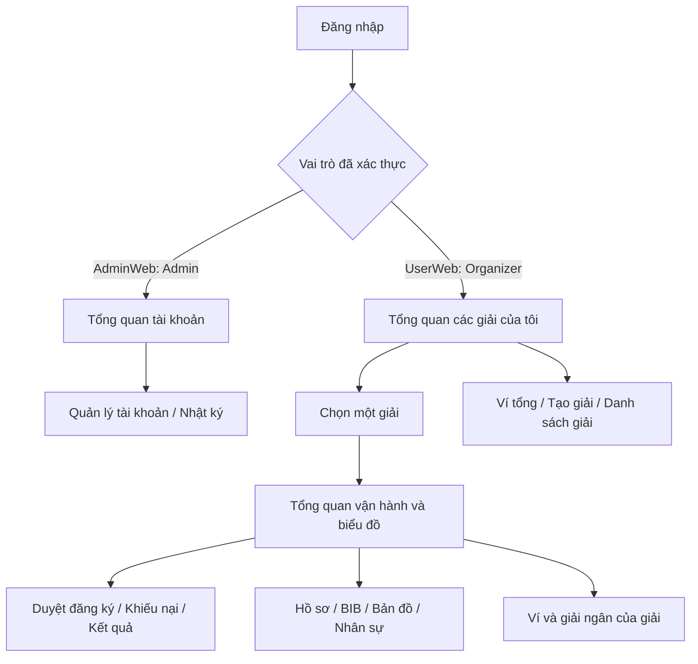

# Dashboard Admin và Organizer — luồng giao diện

## 1. Mở màn hình ở đâu?

| Người dùng | Web | Đường dẫn | Cách vào |
| --- | --- | --- | --- |
| Admin | AdminWeb | `/` (rewrite nội bộ sang `/admin`) | Đăng nhập Admin → Dashboard trên sidebar |
| Organizer | UserWeb | `/organizer` | Menu tài khoản → Dashboard; hoặc từ Giải của tôi |
| Organizer, một giải | UserWeb | `/organizer/events/{eventId}` | Chọn giải → tab Tổng quan |

Trang quản lý tài khoản Admin vẫn ở `/users`, nhật ký ở `/audit`. Danh sách giải vẫn ở `/my-events`. Dashboard Admin chỉ quản trị tài khoản và nhật ký; dashboard Manager không thuộc thay đổi này.

## 2. Luồng chung



1. Server kiểm tra session và vai trò bằng auth flow sẵn có.
2. Các khối tải dữ liệu độc lập qua Axios → BFF `/api/backend/` → WebAPI.
3. Chọn ngày rồi **Áp dụng**, hoặc chọn nhanh **7 / 30 / 90 ngày**, để tải biểu đồ.
4. **Làm mới** tải lại số liệu hiện tại và biểu đồ của màn hình.
5. Nếu một API lỗi, khối đó hiển thị lỗi và **Thử lại**; các khối khác vẫn sử dụng được. Lỗi không được hiển thị thành số 0.
6. Đổi giải / đổi khoảng ngày bỏ qua phản hồi cũ. Dashboard không tự duyệt đơn, xử lý khiếu nại hoặc tạo lệnh rút tiền.

## 3. AdminWeb

| Khối | Dữ liệu | API (tiền tố `/api/v1`) |
| --- | --- | --- |
| 2 thẻ tổng quan | Tổng tài khoản hiện tại và tài khoản mới trong kỳ | `GET /iam/admin/dashboard` |
| Trạng thái tài khoản | Đã kích hoạt, chờ xác thực email, đã khóa | Cùng API |
| Biểu đồ tài khoản mới | Tổng mới trong kỳ và số tài khoản tạo theo từng ngày | Cùng API, tham số `from`, `to` |
| Phân bố vai trò | Số tài khoản theo vai trò hiện tại | Cùng API |
| Hoạt động gần đây | 6 nhật ký mới nhất; nút mở nhật ký đầy đủ | `GET /audit-logs?page=1&pageSize=6` |

**Active là trạng thái tài khoản, không phải số người đang online.** Bộ lọc ngày không lọc tổng tài khoản, phân bố vai trò hoặc danh sách nhật ký.

## 4. Organizer — toàn bộ giải

| Khối | Dữ liệu | API |
| --- | --- | --- |
| Tổng quan | Giải đang mở đăng ký (kèm tổng giải), đơn chờ duyệt, khiếu nại chờ xử lý | `GET /api/v1/event/organizer/dashboard` |
| Việc cần xử lý | Danh sách giải, số việc; nút đến duyệt đăng ký / khiếu nại | Cùng API |
| Trạng thái giải | Gom 6 nhóm; ẩn nhóm 0, có chi tiết mọi trạng thái | Cùng API |
| Giải sắp diễn ra | Tối đa 5 giải phù hợp, có ngày và liên kết vào giải | Cùng API |
| Ví ban tổ chức | Có thể rút, ký quỹ, đã rút | `GET /api/v1/finance/organizer/wallet` |
| Dòng tiền vé | Đã thu, đã hoàn, dòng tiền ròng theo khoảng ngày | `GET /api/v1/finance/organizer/revenue-trend?from=&to=` |

`pendingTasks = pendingRegistrations + pendingComplaints`; không gồm đơn chờ thanh toán, duyệt hồ sơ giải hoặc yêu cầu giải ngân.

Giải sắp diễn ra chỉ gồm trạng thái Approved / RegistrationOpen / Closed, ngày tổ chức từ hôm nay theo giờ Việt Nam. Giải mới tạo chưa được duyệt có thể xuất hiện ở phân bố trạng thái nhưng chưa nằm trong lịch này.

## 5. Organizer — một giải

| Khối | Nội dung |
| --- | --- |
| KPI | Tổng đơn, đăng ký đã xác nhận (Confirmed + Finished), check-in, khiếu nại chờ xử lý |
| Đăng ký | Gom 4 nhóm; đi tới tab duyệt; mở xem mọi trạng thái khi cần |
| Thi đấu | Chưa xuất phát, đang chạy, hoàn thành, DNS, DNF, DQ |
| Sức chứa | Chỗ đang giữ / sức chứa từng cự ly; số đăng ký đã xác nhận/hoàn thành |
| Chuẩn bị | Cự ly có BIB; tuyến đường; checkpoint; phân công nhân sự; tài liệu còn thiếu |
| Tài chính | Tiền vé theo sổ tài chính, phí nền tảng, đã hoàn, có thể rút và ghi chú chính sách |
| Biểu đồ đăng ký | Tổng đơn tạo theo ngày; chọn tất cả hoặc một cự ly |
| Dòng tiền vé | Thu/hoàn theo ngày, tách riêng từng loại tiền |

Các API:

- `GET /api/v1/event/organizer/{eventId}/dashboard`
- `GET /api/v1/event/organizer/{eventId}/dashboard/registrations-trend?from=&to=`
- `GET /api/v1/finance/organizer/revenue-trend?eventId=&from=&to=`
- `GET /api/v1/finance/organizer/events/{eventId}/summary`

Trang tiếp tục dùng API chi tiết giải hiện có để hiển thị tên, ngày tổ chức, địa điểm, cự ly và tải bảng xếp hạng. Tab duyệt đăng ký và tài chính tiếp tục sử dụng luồng nghiệp vụ cũ.

## 6. Cách đọc đúng số liệu

Cả ba dashboard có nút **Xuất Excel / Xuất PDF** theo kỳ biểu đồ đã áp dụng; API tải lại số liệu và kiểm tra quyền trước khi tạo file. Xem [luồng xuất báo cáo dashboard](dashboard-export.md) để biết nội dung file, các nhóm trạng thái và phạm vi bộ lọc.

- **Tổng đơn / đăng ký mới:** bao gồm đơn chưa thanh toán, bị từ chối hoặc đã hủy; không gọi đây là vé bán thành công.
- **Đã xác nhận / hoàn thành:** tổng Confirmed + Finished; là mẫu số check-in và phạm vi thống kê thi đấu.
- **Chỗ đang giữ:** lấy `reservedSlots`; không đồng nghĩa thanh toán thành công. `capacity <= 0` hiển thị **Không giới hạn**.
- **Chuẩn bị:** các dữ kiện cấu hình; không tự kết luận đã đủ điều kiện mở giải.
- **Thu / hoàn:** dựa trên thời điểm thanh toán/hoàn thành công. Có thể khác số liệu tích lũy trong ví.
- **Dòng tiền ròng = đã thu − đã hoàn trong kỳ.** Có thể âm; chưa trừ phí, không phải lợi nhuận hay số tiền có thể rút.
- **Tiền có thể rút:** dùng API ví / summary hiện có, không tự tính từ biểu đồ.
- Biểu đồ tiền không cộng các loại tiền tệ với nhau.
- Nếu môi trường bật `NEXT_PUBLIC_FINANCE_USE_MOCK=true`, ví / summary theo cấu hình cũ và màn hình ghi rõ đang mô phỏng. API dashboard và biểu đồ mới luôn gọi backend.

## 7. Bộ lọc, hiển thị và trạng thái

- Mặc định 30 ngày, kết thúc hôm nay theo UTC+7.
- Ngày dạng `yyyy-MM-dd`, bao gồm cả hai đầu; tối đa 366 ngày; năm 1900–9998.
- Không đổi ngày thuần sang giờ địa phương của máy khi hiển thị nhãn biểu đồ.
- Mỗi biểu đồ có **Xem bảng số liệu theo ngày** để đọc số chính xác và sử dụng bằng bàn phím.
- Có trạng thái đang tải, chưa có phát sinh, chưa có giải, lỗi và thử lại.
- Thời điểm `generatedAtUtc` được hiển thị theo giờ Việt Nam; dashboard không tự cập nhật theo thời gian thực.

## 8. Vị trí code

Cả hai frontend:

- `src/api/dashboard.ts`: gọi API.
- `src/dto/dashboard.dto.ts`: hợp đồng phản hồi.
- `src/components/dashboard/`: giao diện dashboard và biểu đồ SVG.
- `src/hooks/useDashboardResource.ts`: tải dữ liệu độc lập, retry và bỏ qua phản hồi cũ.
- `src/lib/dashboard.ts`: khoảng ngày, kiểm tra ngày và định dạng.
- `tests/dashboard.test.mjs`: mốc ngày Việt Nam, năm nhuận, khoảng ngày không hợp lệ.

Admin: `src/app/admin/page.tsx`, menu `src/config/ops-nav.ts`.

Organizer: `src/app/(organizer)/organizer/page.tsx`; component `EventDashboard` được gắn vào tab Tổng quan của `events/[id]/page.tsx`. Sidebar, menu tài khoản và trang Giải của tôi có liên kết tới tổng quan.

## 9. Chạy và kiểm tra

Cấu hình API của frontend trỏ tới WebAPI có 5 endpoint mới, sau đó chạy lệnh trong từng repo:

```powershell
npm run dev
npx tsc --noEmit
node --test tests/dashboard.test.mjs
npm run test:auth
npm run build
```

Mặc định AdminWeb ở cổng 3001, UserWeb ở cổng 3000. Không cần migration hay thư viện biểu đồ mới.

Checklist khi nối dữ liệu thật:

1. Đăng nhập Admin: trang đầu là Dashboard; Người dùng / Nhật ký vẫn hoạt động.
2. Đăng nhập Organizer: vào tổng quan từ menu; chỉ thấy giải thuộc tài khoản.
3. Mở một giải, xem KPI, chọn cự ly và đổi khoảng ngày của biểu đồ.
4. Đi đến tab duyệt, khiếu nại, BIB, hồ sơ, nhân sự và ví qua liên kết.
5. Kiểm tra tài khoản không có giải, cự ly không giới hạn, ngày không phát sinh.
6. Kiểm tra mạng lỗi: có nút thử lại; tài chính không biến thành số 0.
7. Kiểm tra quyền sở hữu, thanh toán/hoàn thực và ngày sát 00:00 UTC+7 trên môi trường backend thật.

Chi tiết hợp đồng và cách tính ở [dashboard-api.md](dashboard-api.md).

## 10. Kết quả kiểm tra khi triển khai

- Build production và TypeScript của cả AdminWeb/UserWeb: đạt.
- ESLint các file dashboard mới: đạt. Các file UserWeb hiện có được gắn thêm dashboard/menu vẫn có 4 lỗi `react-hooks/set-state-in-effect` và 4 cảnh báo từ trước; đã đối chiếu với HEAD, số lỗi/cảnh báo không tăng.
- Test khoảng ngày: 3/3 mỗi frontend, tổng 6 test đạt.
- Admin `test:auth`: 16 đạt, 1 test cần backend thật được bỏ qua. Test điều hướng đã cập nhật cho trang chủ `/`.
- UserWeb `test:auth`: 5 đạt, 1 bỏ qua, 1 lỗi có sẵn do test VM không resolve được `@/config/global-config`; không sửa auth để né lỗi test.
- Kiểm tra Chrome với API fixture riêng: 3 màn hình ở 375 / 768 / 1280 px; không tràn ngang. Đã kiểm tra preset ngày, giới hạn 366 ngày, chọn cự ly, bảng số liệu, sức chứa không giới hạn, loading, empty, lỗi từng khối, retry và chuyển về login khi thiếu session. Không có lỗi JavaScript ở lượt kiểm tra cuối.
- Đã kiểm tra lại trực quan ô ngày trên điện thoại sau khi sửa chiều rộng và phần tiêu đề giải dài.

Fixture chỉ dùng trong tiến trình kiểm thử cục bộ; không được đưa vào API production hay dashboard. Các kiểm tra này không chứng minh dữ liệu thanh toán/hoàn tiền và phân quyền trên PostgreSQL thật. Cần kiểm tra mục 9 với môi trường triển khai.

